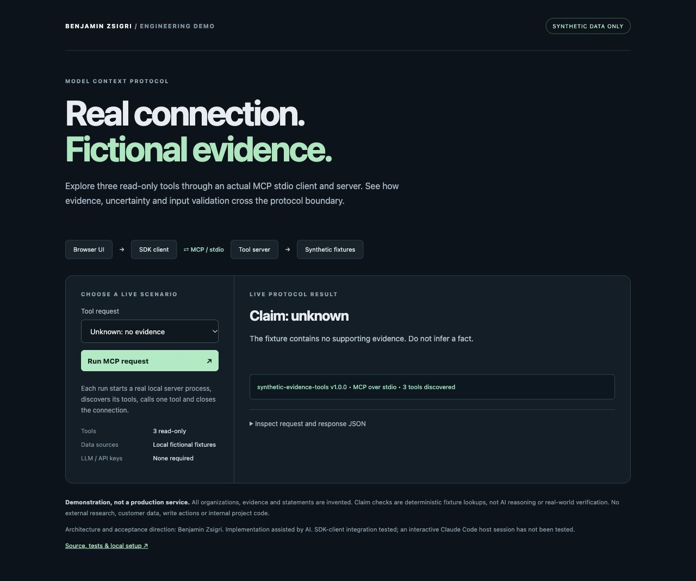

# MCP Evidence Tools — Synthetic Data Demo

**[Try the live synthetic demo](https://tribloc-mcp-tools.pages.dev/)** — no installation or local server required.

## Hosted browser version

The public UI uses the official SDK client to connect to this site's real Streamable HTTP MCP endpoint at `/mcp`. The server exposes the same three read-only synthetic-fixture tools as the local stdio version. No LLM, real research, credentials or customer integration is involved. All six hosted browser scenarios passed. The combined stdio, HTTP and local-web suite now has **36 passing tests**.

The HTTP handler creates a fresh server per request, uses a CSP-compatible schema validator, bounds request bodies and checks the site origin. It has no user/session data or write tools. This is an anonymous synthetic demonstration, not a production authenticated MCP service. The local stdio setup below remains available.

Run `npm ci --ignore-scripts`, then `npm run build` for the Pages asset/endpoint bundle. [Hosted checks](docs/hosted-checks.json).

A real Model Context Protocol client/server demonstration over **stdio**, with three read-only tools and entirely fictional data. Independently built as a public portfolio sample; it contains no private project code, customer records, credentials or internal architecture.



## What runs

```text
Browser UI → local HTTP bridge → official MCP SDK client
                                     ⇅ MCP over stdio
                               official MCP SDK server → fictional JSON fixture
```

The browser is an optional local presentation layer. Each run launches a child server, establishes an MCP connection, discovers tools, calls one tool and closes the connection. The JSON shown in the UI comes from that run. The command-line client uses the same path.

| Tool | Input | Output |
| --- | --- | --- |
| `list_demo_accounts` | Bounded integer limit, 1–2 | Fictional account summaries |
| `get_demo_brief` | Allowlisted synthetic account ID | Invented evidence with explicit provenance |
| `check_demo_claim` | Allowlisted account ID and claim enum | `supported`, `unknown` or `hypothesis`, with fixture evidence IDs |

Every successful tool output includes `synthetic: true` and a fictional-data notice. “Supported” means supported **only by the invented fixture**, never verified in the real world. Claim evaluation is deterministic lookup, not AI reasoning. Tool annotations describe behavior; they are not an authorization mechanism.

## Run locally

Requires Node.js 22 or newer and npm. Tested with Node.js 24.19.0. Dependency installation needs network access; demo execution does not make external research or model API requests.

```sh
npm ci --ignore-scripts
npm test
npm run demo
npm run web
```

Open **http://127.0.0.1:8766/** for the UI. Keep the terminal running. `DEMO_PORT=8767 npm run web` selects a different local port. The UI binds only to `127.0.0.1`; do not expose it publicly.

Inspect another scenario without a browser:

```sh
node client.js list
node client.js brief
node client.js supported
node client.js unknown
node client.js hypothesis
node client.js refused
```

`npm start` runs the MCP stdio server directly and waits for an MCP client, rather than printing a web page. Its stdout is reserved for protocol traffic. A compatible local MCP host can launch `node` with the absolute path to `server.js` as its argument. This repository does not change any host settings.

## Validation evidence

On 2026-10-17, **27 automated tests passed**:

- Real SDK client/server connection, server identity/capabilities and tool discovery.
- Successful tool calls, synthetic provenance and evidence references.
- Unknown versus hypothetical claims without manufactured evidence.
- Schema refusals for unrecognized IDs, paths/instructions instead of IDs, extra/missing fields, invalid limit types/ranges and unsupported claims.
- Unregistered write tool refusal and a valid call after invalid input in the same session.
- Local HTTP bridge result, origin/Host checks, method/route restrictions and disclosure/CSP.

All **six UI scenarios** were also exercised in a browser. Reports: [automated tests](docs/test-report.txt), [browser checks](docs/browser-checks.json), [example real MCP response](docs/sample-response.json). The sample JSON and screenshot are recorded examples; the UI executes fresh calls. These are focused demonstration checks, not a security audit or a general prompt-injection defense claim.

## Boundaries

- Two invented organizations and local synthetic evidence only. No real business research was performed.
- No LLM inference, API keys, external CRM, outreach, writes, arbitrary URLs or arbitrary filesystem access tools.
- No copied internal implementation, access details or proprietary topology.
- SDK client integration tested. An interactive Claude Code or other LLM host session has **not** been tested.
- Local runnable source demonstration, not a production service. No remote authentication, tenant separation or production operations are implemented.
- Input validation blocks the tested invalid shapes; it does not establish broad protection against all adversarial inputs.

## Implementation and attribution

Architecture, scope and acceptance direction: **Benjamin Zsigri**. Implementation assisted by AI. Built as an independent public demonstration of MCP tool integration and explicit evidence boundaries, not presented as a client engagement or production outcome.

Uses official MCP TypeScript SDK packages `@modelcontextprotocol/server` and `@modelcontextprotocol/client` 2.3.1 with Zod 4.6.7. Dependencies are pinned in `package-lock.json`.

Primary references: [official first-server guide](https://github.com/modelcontextprotocol/typescript-sdk/blob/main/docs/get-started/first-server.md), [first-client guide](https://github.com/modelcontextprotocol/typescript-sdk/blob/main/docs/get-started/first-client.md), [stdio serving](https://github.com/modelcontextprotocol/typescript-sdk/blob/main/docs/serving/stdio.md). Third-party package licenses remain with their respective authors.
